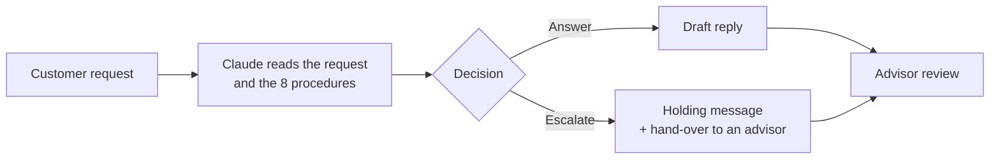

# Support-request triage and draft-reply assistant

Demonstration project: an assistant (n8n + Claude) that reads a customer request, decides whether it can answer or must hand the request to a human advisor, and writes a draft that the advisor reviews. It is evaluated the way a tool would be evaluated for a client: with a reference to compare against, separate test sets, a cost measurement and an error log.

> **Everything is fictional.** The company (a sports retailer), its procedures and all the requests are invented. No real customer data was used. The requests were written by Claude (some at the author's request, who reviewed and corrected the labels of the last series). Results therefore describe behaviour on invented cases, not on a real support flow.
>
> **Language and measurement note.** This is the English edition of the project. The data, procedures and prompts were **translated** from the French original; the figures in this repository (results, comparison, error log, case study) were **measured on the French-language run** and have **not been re-measured** on the English translation. Translating can change a model's behaviour, so treat the English prompts and data as a faithful translation, not as a re-validated version. The raw outputs in `evaluation/` are the French run's (French headers, drafts in French).

## What the assistant does

- It applies **8 fictional procedures** (delivery, returns, warranty, payment, order changes, product questions, customer account, complaints), all written into the prompt.
- It promises no goodwill gesture, no exception and no unplanned date, and escalates in case of doubt, threats, safety issues, personal data or anything outside the procedures.
- It returns a structured result (procedure, decision, reason, draft). If the answer cannot be parsed, it escalates for safety.
- **It never sends anything by itself**: a human reviews every draft.

## Results

Every figure is **measured** on the sets indicated, with **a single run** per version. The sets are small: a difference of one or two cases proves nothing (the same prompt changes its decision on 1 or 2 requests from one run to the next).

| Dataset | Version | Correct decisions | Escalations caught | Needless escalations |
|---|---|---|---|---|
| Test (64 requests, 8 to escalate) | Keyword baseline, no AI | 51/64 (80%) | 3/8 | 8 out of 56 |
| | Prompt v1, Haiku 5.5 | 58/64 (91%) | 8/8 | 6 |
| | Prompt v2, Haiku 5.5 | 57/64 (89%) | 8/8 | 7 |
| | Prompt v2.1, Haiku 5.5 | 58/64 (91%) | 8/8 | 6 |
| | Prompt v2.1, Sonnet 5.5 | 64/64 (100%) | 8/8 | 0 |
| Validation (16, of which 2 to escalate, never used to write the prompt) | v2.1, Haiku 5.5 | 14/16 | 2/2 | 2 |
| Edge cases (21, all to escalate) | v1 / v2, Haiku 5.5 | 20/21 / 21/21 | 20 / 21 | – |
| "Real-style" (15, of which 9 to escalate) | v2.1, Haiku 5.5 and Sonnet 5.5 | 13/15 for both | 7/9 | – |

Key takeaways:
- The main gain comes from moving from keywords to a language model, especially on escalations (8/8 versus 3/8).
- Versions 2 and 2.1 improve the **form** of the drafts (greeting in 100% of cases, order number requested when needed), not the accuracy of the decisions.
- **Sonnet 5.5 wrongly escalates no request on the test set, against 6 for Haiku 5.5**, but does no better on the 15 "real-style" requests. Its 64/64 should be read with caution: two labels (D043, D055) were debatable, and two of its answers remain questionable (see the error log).
- The score is measured against labels I wrote myself; some are debatable and are documented (never changed after seeing the results, except for dated corrections).

### Cost (measured from the account balance, one-cent precision)

| Model | Cost per request |
|---|---|
| Claude Haiku 5.5 | about $0.001 (between 0.0008 and 0.0013) |
| Claude Sonnet 5.5 | about $0.012 (about 13 times more) |

The cost includes the model's internal "thinking", billed as output text. Assumptions: currency in dollars, no other API call between two balance readings.

### Draft quality

40 drafts from v1 were scored on a 4-criterion grid (accuracy, completeness, relevance, usefulness) **by an AI model**, then 10 rows were re-checked by hand (40 scores out of 40 identical). This control sample is small and easy: it does not show that AI scoring is reliable on hard cases. After correcting 5 rows, 24 drafts out of 40 score 4 out of 4 on every criterion.

## Known limitations

- Data written with the same approach as the procedures and the prompt: results are probably too favourable.
- A single run per version; run-to-run variation not measured.
- Some requests have several plausible procedures: the "expected procedure" label is arbitrary there.
- Drafts sometimes contain common-sense advice absent from the procedures (for example "stop using the water bottle as a precaution"): this is why human review is required.
- No test on real requests, real product sheets or real ticketing systems.

Details are in [`evaluation/error_log.md`](evaluation/error_log.md) (13 errors, with cause, fix and decision) and [`evaluation/version_comparison.md`](evaluation/version_comparison.md).

## Method

1. **Scoping**: problem, scope and success criteria before building ([`docs/scoping.md`](docs/scoping.md), [`docs/process.md`](docs/process.md)); written up in a [case study](docs/case_study.md).
2. **Data**: 80 synthetic requests (64 test, 16 validation), 21 edge cases all to escalate, 15 "real-style" requests.
3. **Baseline**: a keyword script, no AI, to know what a simple tool is worth.
4. **Evaluation**: the decision is compared to the label; the key measure is the share of escalations caught (a "never escalate" rule would score 87.5% correct decisions but catch 0 escalations).
5. **Iterations**: v1, v2, v2.1; each added rule comes from an error analysis, then is tested on a set that did not inspire it (the validation set).
6. **Error log**: each error with its cause, the planned fix and the decision taken.

## Repository contents

| Folder or file | Contents |
|---|---|
| [`docs/`](docs/) | [Scoping](docs/scoping.md), [process description](docs/process.md) and [case study](docs/case_study.md) |
| [`data/procedures/`](data/procedures/) | The 8 fictional procedures |
| [`data/`](data/) | Synthetic requests (test and validation), edge cases, "real-style" requests |
| [`prompts/`](prompts/) | Prompts v1, v2 and v2.1 (English translation of the prompts used in the measured runs) |
| [`workflow/`](workflow/) | n8n workflow export (translated prompt and test requests) |
| [`baseline/`](baseline/) | Keyword reference script |
| [`evaluation/`](evaluation/) | Results per version (raw outputs of the French run), draft scoring, human check, comparison, error log |

## Reproduce

1. An n8n Cloud account (the free trial is enough) and an Anthropic API key with a small credit (a few dollars is enough).
2. Import the workflow, paste the chosen prompt into the "Message a model" node, enter the key.
3. The "Demandes" node of the export holds the 64 test requests. To run another set (16 validation requests, 21 edge cases, 15 "real-style"), build the same list from the CSV files in `data/` (columns `id` and `request`; the node expects the key `demande`), then run.
4. Compare the output of the "Lecture" node with the labels in the `data/` folder (`expected_decision`: answer / escalate; the model outputs `repondre` / `escalader`).
5. Results will differ from those published here: they were obtained in French, and a single run is not deterministic.

Important setting: set "Maximum Number of Tokens" to 4000, otherwise the model's internal thinking can cut the answer short.

## Another project in this portfolio

[Media-prospecting preparation assistant](https://github.com/pxulng/prospecting-assistant) (n8n + Claude, synthetic data; documentation in French): same evaluation approach (no-AI baseline, validation set used once, two models compared, blind human check, error log) on a different use case.

## What remains to be done on this project

- Demo video and user guide.
- A test on real requests: not done, and it is the project's main limitation.

Paul Nguyen Phuoc [LinkedIn](https://www.linkedin.com/in/paul-nguyen-phuoc-336456294)
