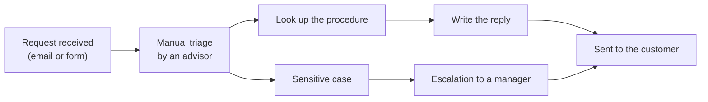
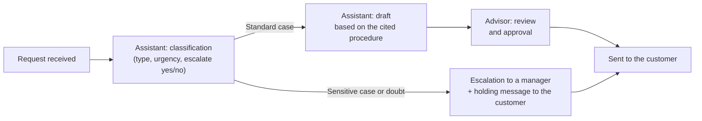

# Process: before and after

> Diagram for the fictional client. The "after" is the target to test, not a measured result.

## Current process (manual)

## Target process (with the assistant)

**Principle:** the assistant never replies on its own. A human reviews every draft and handles every sensitive case.
